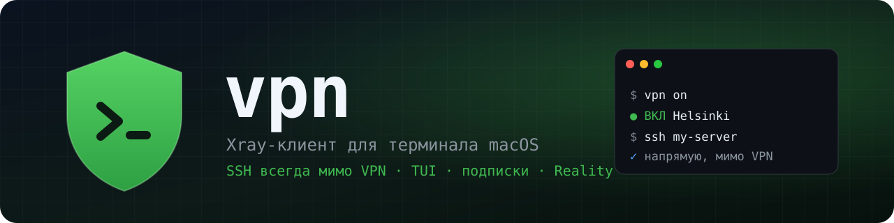
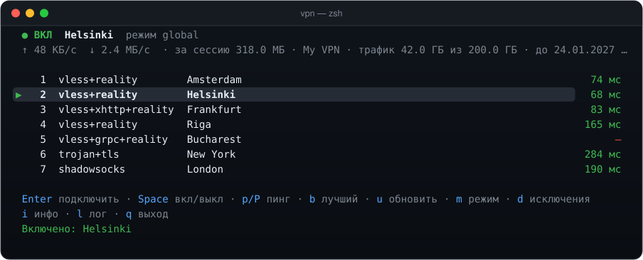
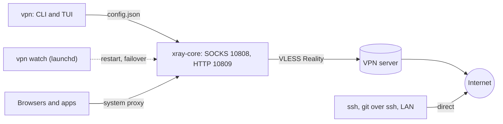

<p align="center">
  
</p>

<p align="center">
  <a href="https://github.com/pnnnx/vpn/releases/latest"></a>
  <a href="https://github.com/pnnnx/vpn/actions/workflows/ci.yml"></a>
  <a href="#-install"></a>
  
  <a href="go.mod"></a>
  <a href="LICENSE"></a>
</p>

<p align="center">
  <b>Type <code>vpn</code>, pick a server, press <code>Enter</code>. And <code>ssh</code> to your own servers keeps working.</b>
</p>

<p align="center">
  <a href="#-install">Install</a> ·
  <a href="#-quick-start">Quick start</a> ·
  <a href="#️-keys">Keys</a> ·
  <a href="#-how-it-works">How it works</a> ·
  <a href="https://pnnnx.github.io/vpn/en/">Website</a> ·
  <a href="README.md">Русский</a>
</p>

<p align="center">
  
</p>

> [!NOTE]
> The interface follows your macOS language (Russian or English). Force it with `vpn lang en`.

## 🤔 Why

Big VLESS clients often run in TUN mode and send **all** traffic through the VPN, SSH included, while many VPN servers block outbound port 22. The result: no `ssh` to your own servers while the VPN is on.

`vpn` is a small terminal client built on [Xray-core](https://github.com/XTLS/Xray-core). It runs as a local proxy, toggles the macOS system proxy for you and **never routes SSH or your LAN through the VPN**.

## ✨ Features

| | |
|---|---|
| 🛡 **SSH bypasses the VPN** | Port 22, private networks and localhost always go direct, plus your own domain, IP and CIDR exclusions |
| 🖥 **TUI and CLI** | Bubble Tea UI with colored latency, live ↑/↓ speed, log and exclusions screens; `vpn on`/`off`/`status` for scripts |
| 🔗 **Subscriptions** | Marzban, Remnawave, 3x-ui and others; updated daily, with remaining traffic and expiry date |
| 🧪 **TUN mode** | Experimental: route every app through the VPN (`vpn tun on`, then `sudo vpn on`) |
| 🔐 **Protocols** | VLESS (TCP, WS, gRPC, XHTTP, HTTPUpgrade; TLS and **Reality**), VMess, Trojan, Shadowsocks |
| 🔁 **Self-healing** | A launchd watcher brings the VPN back after a reboot, restarts a crashed xray and fails over to the fastest server |
| ⚡ **Real latency** | A request through every server, not a TCP connect; `b` jumps to the fastest |
| 📦 **Zero setup** | A single binary; the Xray core downloads itself and is SHA-256 verified |

## 📥 Install

```sh
brew install --cask pnnnx/tap/vpn
```

<details>
<summary><b>Other options</b></summary>

<br>

```sh
# prebuilt binary (use amd64 on Intel)
mkdir -p ~/.local/bin
curl -fsSL https://github.com/pnnnx/vpn/releases/latest/download/vpn_darwin_arm64.tar.gz | tar xz -C ~/.local/bin vpn

# Go 1.24+
go install github.com/pnnnx/vpn@latest
```

</details>

## 🚀 Quick start

```sh
vpn sub 'https://your-subscription-url'   # 1. load servers
vpn                                       # 2. P — real ping, b — fastest, Enter — connect
vpn autostart on                          # 3. optional: autostart and failover
```

## ⌨️ Keys

<table>
<tr><th>Key</th><th>Action</th><th>Key</th><th>Action</th></tr>
<tr><td><kbd>Enter</kbd></td><td>connect</td><td><kbd>d</kbd></td><td>exclusions</td></tr>
<tr><td><kbd>Space</kbd></td><td>on / off</td><td><kbd>i</kbd></td><td>server details (secrets masked)</td></tr>
<tr><td><kbd>p</kbd> / <kbd>P</kbd></td><td>TCP / real ping</td><td><kbd>l</kbd></td><td>xray and watcher log</td></tr>
<tr><td><kbd>b</kbd></td><td>jump to fastest</td><td><kbd>m</kbd></td><td>mode global ↔ ru</td></tr>
<tr><td><kbd>u</kbd></td><td>update subscription</td><td><kbd>q</kbd></td><td>quit (the VPN keeps running)</td></tr>
</table>

Commands: `on [N]`, `off`, `toggle`, `status`, `sub <url>`, `update`, `add <link>`, `list`, `use N`, `ping [--real]`, `best`, `test`, `mode global|ru`, `direct add|rm|list`, `autostart on|off`, `autoswitch on|off`, `sysproxy on|off`, `tun on|off`, `autoupdate on|off`, `lang ru|en|auto`, `env [--off]`, `setup`, `config`, `log`, `version`.

## 🧭 How it works



Terminal `ssh` ignores the system proxy. On top of that, the first Xray routing rule sends port 22 and all private ranges to `direct`, so SSH stays direct even when traffic is forced through Xray. State lives in `~/.config/vpn/` (`state.json` is mode `0600` because it contains keys).

## 🤝 Contributing

See [CONTRIBUTING.md](CONTRIBUTING.md) and [SECURITY.md](SECURITY.md).

> [!WARNING]
> Never post real share links or subscription URLs in issues: they contain your access keys.

## 📄 License

[MIT](LICENSE) © [pnnnx](https://github.com/pnnnx)
