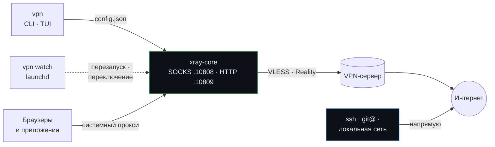

<p align="center">
  
</p>

<p align="center">
  <a href="https://github.com/pnnnx/vpn/releases/latest"></a>
  <a href="https://github.com/pnnnx/vpn/actions/workflows/ci.yml"></a>
  <a href="#-установка"></a>
  
  <a href="go.mod"></a>
  <a href="LICENSE"></a>
</p>

<p align="center">
  <b>Набираешь <code>vpn</code> — выбираешь сервер — <code>Enter</code>. А <code>ssh</code> на свои серверы продолжает работать.</b>
</p>

<p align="center">
  <a href="#-установка">Установка</a> ·
  <a href="#-быстрый-старт">Быстрый старт</a> ·
  <a href="#️-управление">Управление</a> ·
  <a href="#-как-это-работает">Как это работает</a> ·
  <a href="#-решение-проблем">FAQ</a> ·
  <a href="https://pnnnx.github.io/vpn/">Сайт</a> ·
  <a href="README.en.md">English</a>
</p>

<p align="center">
  
</p>

## 🤔 Зачем

Большие клиенты для VLESS (v2rayN, Hiddify, Nekoray и др.) часто работают в TUN-режиме и заворачивают через VPN **весь** трафик. Под раздачу попадает и SSH, а многие VPN-серверы режут исходящий порт 22. В итоге при включённом VPN на свои серверы не зайти.

`vpn` — маленький консольный клиент на базе [Xray-core](https://github.com/XTLS/Xray-core). Он работает как локальный прокси, сам включает системный прокси macOS и **никогда не пускает SSH и локальную сеть через VPN**.

## ✨ Возможности

<table>
<tr>
<td width="33%" valign="top">

**🛡 SSH мимо VPN**<br>
Порт 22, приватные сети и `localhost` всегда идут напрямую. Плюс свои исключения: домены, IP, подсети.

</td>
<td width="33%" valign="top">

**🖥 TUI и CLI**<br>
Интерфейс на Bubble Tea: пинг с подсветкой, скорость ↑/↓, лог, исключения. Для скриптов — `vpn on` / `off` / `status`.

</td>
<td width="33%" valign="top">

**🔗 Подписки**<br>
Marzban, Remnawave, 3x-ui и другие. Обновляются сами раз в сутки, показывают остаток трафика и срок.

</td>
</tr>
<tr>
<td valign="top">

**🔐 Протоколы**<br>
VLESS (TCP, WS, gRPC, XHTTP, HTTPUpgrade; TLS и **Reality**), VMess, Trojan, Shadowsocks.

</td>
<td valign="top">

**🔁 Сам себя чинит**<br>
Сторож в фоне поднимает VPN после перезагрузки, перезапускает упавший xray и уходит на лучший сервер, если текущий умер.

</td>
<td valign="top">

**⚡ Честный пинг**<br>
Запрос через каждый сервер, а не TCP до порта. `b` — сразу к самому быстрому.

</td>
</tr>
<tr>
<td valign="top">

**🧭 Режимы**<br>
`global` — всё через VPN. `ru` — российские сайты напрямую.

</td>
<td valign="top">

**📦 Без зависимостей**<br>
Один бинарник. Ядро Xray скачивается само, с проверкой SHA-256.

</td>
<td valign="top">

**🍎 Сделан для macOS**<br>
Системный прокси через `networksetup`, автозапуск через launchd, экспериментальный TUN, интерфейс на русском и английском.

</td>
</tr>
</table>

## 📥 Установка

**Homebrew** — самый простой способ, обновления через `brew upgrade`:

```sh
brew install --cask pnnnx/tap/vpn
```

<details>
<summary><b>Другие способы</b></summary>

<br>

**Готовый бинарник** (для Intel замени `arm64` на `amd64`):

```sh
mkdir -p ~/.local/bin
curl -fsSL https://github.com/pnnnx/vpn/releases/latest/download/vpn_darwin_arm64.tar.gz | tar xz -C ~/.local/bin vpn
```

Если `~/.local/bin` нет в PATH:

```sh
echo 'export PATH="$HOME/.local/bin:$PATH"' >> ~/.zshrc && source ~/.zshrc
```

**Через Go** (1.24+):

```sh
go install github.com/pnnnx/vpn@latest
```

**Из исходников:**

```sh
git clone https://github.com/pnnnx/vpn && cd vpn && make build
```

</details>

## 🚀 Быстрый старт

```sh
vpn sub 'https://ссылка-на-подписку'   # 1. загрузить серверы
vpn                                    # 2. P — пинг, b — лучший, Enter — подключиться
vpn autostart on                       # 3. (по желанию) автозапуск и автопереключение
```

При первом включении `vpn` сам скачает ядро Xray, а macOS может спросить пароль — так меняется системный прокси.

## ⌨️ Управление

<table>
<tr><th>Клавиша</th><th>Действие</th><th>Клавиша</th><th>Действие</th></tr>
<tr><td><kbd>Enter</kbd></td><td>подключиться</td><td><kbd>d</kbd></td><td>исключения (мимо VPN)</td></tr>
<tr><td><kbd>Space</kbd></td><td>вкл / выкл</td><td><kbd>i</kbd></td><td>детали сервера (ключи скрыты)</td></tr>
<tr><td><kbd>p</kbd> / <kbd>P</kbd></td><td>TCP / реальный пинг</td><td><kbd>l</kbd></td><td>лог xray и сторожа</td></tr>
<tr><td><kbd>b</kbd></td><td>к самому быстрому</td><td><kbd>m</kbd></td><td>режим global ↔ ru</td></tr>
<tr><td><kbd>u</kbd></td><td>обновить подписку</td><td><kbd>s</kbd></td><td>ссылка на подписку</td></tr>
<tr><td><kbd>↑</kbd><kbd>↓</kbd> <kbd>j</kbd><kbd>k</kbd></td><td>навигация</td><td><kbd>q</kbd></td><td>выйти — <b>VPN продолжит работать</b></td></tr>
</table>

<details>
<summary><b>Все команды CLI</b></summary>

<br>

| Команда | Что делает |
|---|---|
| `vpn` | открыть TUI |
| `vpn on [N]` · `off` · `toggle` | включить / выключить |
| `vpn status` | состояние, сервер, подписка, автозапуск |
| `vpn sub <url>` · `update` | задать / обновить подписку |
| `vpn autoupdate on\|off` | обновлять подписку раз в сутки (по умолчанию да) |
| `vpn add <ссылка>` | добавить сервер вручную |
| `vpn list` · `use N` | список / выбрать сервер |
| `vpn ping [--real]` · `best` | пинг с причинами отказов / выбрать лучший |
| `vpn test` | задержка и внешний IP через VPN |
| `vpn mode global\|ru` | режим маршрутизации |
| `vpn direct add\|rm\|list <x>` | исключения: домен, IP или CIDR |
| `vpn autostart on\|off` | фоновый сторож через launchd |
| `vpn autoswitch on\|off` | переключать сервер при падении |
| `vpn sysproxy on\|off` | трогать ли системный прокси |
| `vpn tun on\|off` | 🧪 TUN-режим для всех программ (нужен `sudo`) |
| `vpn lang ru\|en\|auto` | язык интерфейса |
| `vpn env [--off]` | прокси для терминала: `eval "$(vpn env)"` |
| `vpn setup` | скачать / обновить ядро Xray |
| `vpn config` · `log` · `version` | конфиг Xray, логи, версия |

</details>

## 🧭 Как это работает



- Протоколы `vpn` сам не реализует: криптография и транспорт — это Xray-core. `vpn` собирает для него конфиг и управляет процессом.
- xray живёт в отдельной сессии. Закрытие терминала или выход из TUI VPN не выключает.
- Режим — **локальный прокси, не TUN**. Через VPN идут программы, которые уважают системный прокси: Safari, Chrome, Telegram и большинство приложений.

**Почему SSH работает.** Терминальный `ssh` системный прокси не использует и идёт напрямую. Даже если трафик всё же попадёт в xray (через `vpn env` или proxychains), первое правило маршрутизации отправляет **порт 22 напрямую**. Так же напрямую идут `10/8`, `172.16/12`, `192.168/16`, `100.64/10`, `localhost` и `*.local`.

SSH на нестандартном порту — добавь сервер в исключения:

```sh
vpn direct add 203.0.113.7            # IP
vpn direct add myserver.example.com   # домен и все поддомены
```

### 🔁 Автозапуск и автопереключение

`vpn autostart on` ставит агент launchd, который запускает `vpn watch` при входе в систему. Сторож раз в 30 секунд:

| Ситуация | Что делает |
|---|---|
| Mac перезагрузился, VPN был включён | поднимает xray |
| Mac перезагрузился, VPN был выключен | снимает «висящий» системный прокси |
| xray упал | перезапускает |
| ~1,5 минуты нет ответа через VPN, а интернет напрямую есть | реальный пинг всех серверов → переход на самый быстрый |

`vpn off` сторож уважает и обратно VPN не включает. Без переключения серверов: `vpn autoswitch off`. Убрать агент: `vpn autostart off`.

### 🧪 TUN-режим (экспериментально)

Системный прокси слушают не все программы: часть CLI-утилит, игры, некоторые мессенджеры идут мимо него. TUN заворачивает в VPN **весь** IPv4-трафик системы:

```sh
vpn tun on        # один раз
sudo vpn on       # TUN-интерфейсу нужен root
sudo vpn off
```

Правила остаются прежними: SSH, локальные сети и исключения идут напрямую. Xray сам прописывает маршрут и привязывает свои соединения к физическому интерфейсу, чтобы не было петли. Ограничения: IPv6 через TUN не идёт, а сторож не может поднять TUN после перезагрузки без `sudo`. Вернуться к прокси — `vpn tun off`.

### 🗺 Режимы и терминал

- **`global`** — всё, кроме исключений, идёт через VPN.
- **`ru`** — напрямую идут ещё `.ru`, `.su`, `.рф`, `geosite:category-ru` и `geoip:ru`.

`curl`, `git`, `brew` системный прокси не видят. Для текущего окна терминала: `eval "$(vpn env)"`, выключить — `eval "$(vpn env --off)"`.

### 🗂 Где хранятся данные

Всё лежит в `~/.config/vpn/` (переопределяется переменной `VPN_HOME`):

| Файл | Содержимое |
|---|---|
| `state.json` | подписка, серверы, настройки. Права `0600` — внутри ключи |
| `config.json` | сгенерированный конфиг Xray |
| `xray.log` · `watch.log` | логи ядра и сторожа |
| `bin/` | `xray`, `geoip.dat`, `geosite.dat` |

## 🩺 Решение проблем

<details>
<summary><b>После перезагрузки пропал интернет</b></summary>
<br>
Системный прокси остался включённым, а xray не запущен. Выполни <code>vpn on</code> или <code>vpn off</code>. Чтобы это не повторялось — <code>vpn autostart on</code>.
</details>

<details>
<summary><b>Сервер в пинге «не отвечает»</b></summary>
<br>
<code>vpn ping --real</code> в конце пишет причину: таймаут, обрыв соединения и т.д. Если сервер то отвечает, то нет — проблема у хостера. Со сторожем клиент сам уйдёт на рабочий сервер.
</details>

<details>
<summary><b>«порт 10808 уже занят»</b></summary>
<br>
Работает другой VPN-клиент. Закрой его или поменяй <code>socks_port</code> и <code>http_port</code> в <code>~/.config/vpn/state.json</code>.
</details>

<details>
<summary><b>Подписка или ядро не скачиваются</b></summary>
<br>
Включи VPN на любом сервере и повтори: при неудаче напрямую <code>vpn</code> пробует через себя. Ядро можно поставить и через <code>brew install xray</code>.
</details>

<details>
<summary><b>«xray отклонил конфиг»</b></summary>
<br>
Обнови ядро (<code>vpn setup</code>) и посмотри <code>vpn config</code>. Если ссылка работает в других клиентах — <a href="https://github.com/pnnnx/vpn/issues/new/choose">открой issue</a>, но <b>сначала удали из неё UUID, ключи и адрес сервера</b>.
</details>

<details>
<summary><b>Системный прокси не включается</b></summary>
<br>
<code>networksetup</code> может попросить пароль администратора. Можно не трогать системный прокси совсем: <code>vpn sysproxy off</code> и <code>vpn env</code>.
</details>

## 🛣 Roadmap

- [x] TUI, подписки, VLESS Reality / XHTTP / gRPC, Trojan, Shadowsocks
- [x] SSH и локальные сети всегда напрямую
- [x] Автозапуск, восстановление после перезагрузки и автопереключение
- [x] Скорость и трафик в TUI, экраны исключений, деталей и лога
- [x] Релизы через GoReleaser и Homebrew tap
- [x] Автообновление подписки раз в сутки
- [x] TUN-режим (экспериментально)
- [x] Английский интерфейс (`vpn lang en`)
- [ ] TUN: IPv6 и автозапуск без `sudo` (привилегированный помощник)
- [ ] Подпись и нотаризация бинарников Apple
- [ ] Linux: системный прокси для GNOME / KDE
- [ ] Hysteria2 и TUIC
- [ ] Демо-GIF ([vhs](https://github.com/charmbracelet/vhs))

Есть идея — [предложи](https://github.com/pnnnx/vpn/issues/new/choose).

## 🤝 Участие

Pull request'ы и issue приветствуются — см. [CONTRIBUTING.md](CONTRIBUTING.md). Об уязвимостях пиши приватно — [SECURITY.md](SECURITY.md).

> [!WARNING]
> Никогда не прикладывай к issue реальные ссылки и подписки: в них ключи доступа к твоему VPN.

## 💚 Благодарности

[XTLS/Xray-core](https://github.com/XTLS/Xray-core) · [charmbracelet/bubbletea](https://github.com/charmbracelet/bubbletea) · [charmbracelet/lipgloss](https://github.com/charmbracelet/lipgloss) · [GoReleaser](https://goreleaser.com)

## 📄 Лицензия

[MIT](LICENSE) © [pnnnx](https://github.com/pnnnx)
